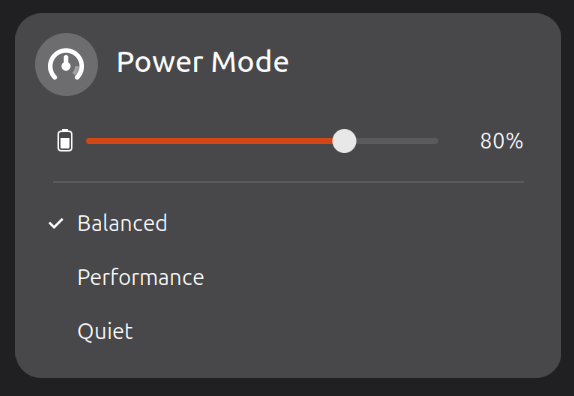

# Quick Controls for asusd

GNOME Shell extension to control asusd from Quick Settings.



## Features

- Switch the power profile: Balanced, Performance or Quiet
- Set the battery charge limit from 20% to 100%, in 10% steps
- Stay in sync when settings are changed with `asusctl` or ROG Control Center

## Requirements

- GNOME Shell 50
- [asusd](https://asus-linux.org) running as a system service

## Installation

### From source

```sh
git clone https://github.com/gabriel654165/asusd-quick-controls.git
cd asusd-quick-controls
gnome-extensions pack --force --extra-source=icons
gnome-extensions install --force asusd-quick-controls@gabriel654165.github.io.shell-extension.zip
```

Log out and back in, then enable it:

```sh
gnome-extensions enable asusd-quick-controls@gabriel654165.github.io
```

## Development

```sh
npm install
npm run lint
```

To publish a release from an up-to-date `main`, use the version as the tag:

```sh
tools/release.sh --dry-run 1.2.3
tools/release.sh 1.2.3 "What changed"
```

The script tags the commit and creates the GitHub release with the zip attached. Upload that zip to [extensions.gnome.org](https://extensions.gnome.org/upload/) afterwards.

## Bug reports

Report problems on the [issue tracker](https://github.com/gabriel654165/asusd-quick-controls/issues).
Include your GNOME Shell version, your asusd version and any errors from:

```sh
journalctl -b -o cat /usr/bin/gnome-shell | grep -i asusd
```

## License

GPL-2.0-or-later. See [LICENSE](LICENSE).
